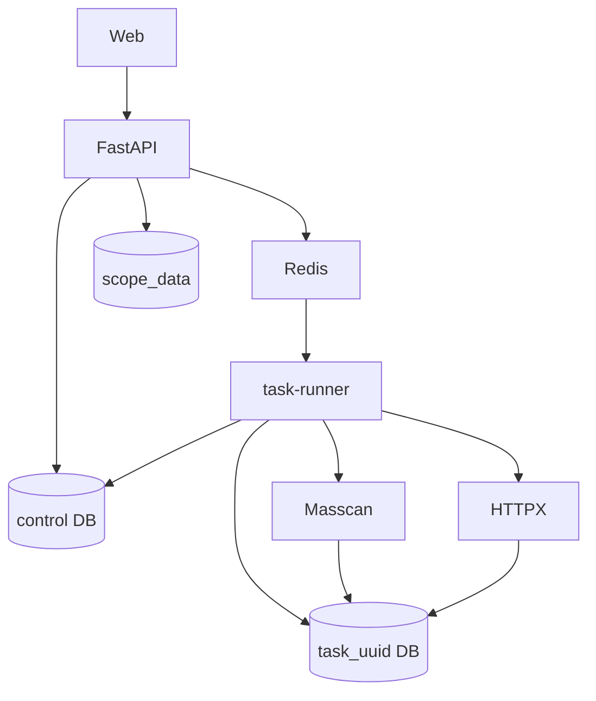

# Архитектура

PostgreSQL — единственный источник данных: `control DB` содержит реестр TASK и
`search_templates` с нормализованными профилями Masscan/HTTPX. Шаблон не содержит
CIDR и не создаёт базу TASK; он используется до запуска и может быть проверен
dry-run API. `task_registry` содержит имя TASK, имя физической базы, исходный файл,
конфигурацию и сводные счётчики. Данные одного запуска никогда
не смешиваются с данными другого запуска.

Redis не является второй SQL-базой. Это короткоживущий Redis Streams транспорт
для события `tasks.created` и сигнал восстановления; результаты, прогресс,
сырые буферы и экспорт всегда читаются из PostgreSQL и каталога TASK.

`task-runner` — рабочий Docker-сервис. Он получает сигнал из Redis, затем сам
читает реестр и подбирает потерянные `queued` TASK. Для TASK он подключается к
его физической базе, расширяет CIDR, создаёт IP-чанки, запускает Masscan,
сохраняет открытые порты, запускает HTTPX и записывает fingerprint.

Внешние сервисы не создают фиктивные наблюдения. API отображает только строки,
которые появились после реального subprocess и SQL-транзакции.

Control database содержит реестр TASK и шаблоны поиска. Развёртывание выполняется на
чистом PostgreSQL volume; физические базы TASK создаются worker-ом через
`CREATE DATABASE` и удаляются вместе с TASK.

Prometheus/Grafana подключаются отдельным Compose-профилем `monitoring`. API
экспортирует container metrics и число TASK по состояниям, а базовая панель
продолжает показывать live-срез без обязательного запуска Grafana.
